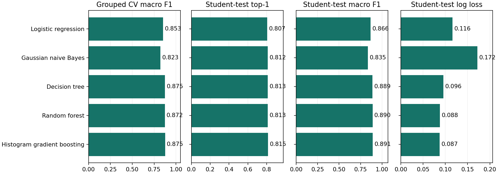

# PathSnap development results

These measurements use the supplied 80 training and 10 student-testing trips. The reserved evaluator data was outside this run.

## Data and methods

The candidate generator retains up to 16 directed arcs within 75 m of each GPS observation using a local metric projection. Features are distance, projected fraction, rank, heading agreement, whether heading is available, and observed speed. Heading and speed are suppressed after gaps over 10 seconds, non-positive steps or movements under 2 m.

An order-constrained minimum squared-distance alignment generates provisional observation labels from the supplied arc sequence. An observation is excluded from supervised metrics when its aligned arc is more than 50 m away. This left **185,159 of 208,417** training observations and **19,133 of 19,160** student-test observations. Training trip `00000054` accounts for 17,274 of 23,258 training exclusions. The concentration makes this result sensitive to the alignment policy. The eligible-label candidate miss rates were **0.46%** in training and **0.03%** in student testing. Reference alignment may still assign the wrong directed arc at junctions and parallel roads.

Three folds grouped by training trip held out complete trips. Candidate fits used up to 300 eligible observations per training trip with seed 42. Validation and student-test metrics used all eligible observations. Candidate macro F1 uses the binary label and a 0.5 threshold. Observation top-1 asks whether the highest scoring candidate equals the aligned arc, including candidate misses in the denominator.

## Model comparison

| Model | Main configuration | Grouped CV macro F1 | Student-test macro F1 | Student-test top-1 | Student-test log loss |
| --- | --- | ---: | ---: | ---: | ---: |
| Logistic regression | Standardized features, L2-regularized log loss, C=1 | 0.8532 | 0.8664 | 80.74% | 0.1161 |
| Gaussian naive Bayes | Gaussian likelihoods, variance smoothing 1e-9 | 0.8231 | 0.8347 | 81.22% | 0.1719 |
| Decision tree | Gini impurity, depth 8, minimum leaf 20 | 0.8749 | 0.8888 | 81.26% | 0.0958 |
| Random forest | 32 Gini trees, depth 10, minimum leaf 20 | 0.8724 | 0.8898 | 81.31% | 0.0880 |
| Histogram gradient boosting | Log loss, 75 iterations, 15 leaves, learning rate 0.10 | 0.8754 | 0.8910 | 81.49% | 0.0873 |

Logistic regression gives a linear baseline and underperformed the tree models on grouped validation. Naive Bayes achieved comparable top-1 to the shallow tree but had the highest log loss, consistent with weaker probability estimates from correlated features such as distance and rank. The shallow decision tree came within 0.0005 CV F1 of the winner and was the fastest scorer in this run. The forest reduced student-test log loss compared with the single tree. Histogram gradient boosting had the highest CV F1 and lowest student-test log loss of the initial runs, with the slowest scoring time. The small CV margin limits claims of a meaningful advantage over the decision tree.

The [experiment log](results/experiments.json) records fold assignments, timings, precision, recall, confusion matrices and model configurations. [Machine-readable comparison](results/model_comparison.csv).

## Bayesian search and full refit

The six-trial search used a Matérn Gaussian-process surrogate and expected improvement over leaf counts `[7, 15, 31, 63]` and learning rates `[0.025, 0.05, 0.10, 0.20]`. It maximized mean grouped training-fold candidate macro F1. The default configuration remained the best observed trial. Both the untuned and selected configurations were refit on all eligible training observations, so they produced the same student-test macro F1 (0.8914), top-1 (81.29%), and log loss (0.0863). The search found no improvement within its trial budget.

## Route reconstruction

Viterbi uses candidate arc positions as states, normalized classifier scores as emissions, and the discrepancy between directed network distance and GPS displacement as its transition cost. It splits route sections when candidates are missing, timestamps are invalid or more than 30 seconds apart, or every transition is infeasible. Sequence similarity compares ordered matching blocks after collapsing consecutive repeated arc IDs on eligible observations. The classifier-only continuity calculation uses the same graph feasibility checks with only the locally best candidate available at each observation.

| Student-test measurement | Classifier only | Classifier + Viterbi |
| --- | ---: | ---: |
| Pointwise accuracy | 81.29% | 79.38% |
| Mean trip sequence similarity | 0.6272 | 0.7604 |
| Impossible transitions | 1,962 | 72 |
| Route sections | 1,974 | 84 |

Viterbi improved route continuity and ordered similarity at a cost of 1.92 percentage points in pointwise agreement. Trip `00000009` improved from 82.65% to 86.94%, while `00000007` fell from 90.40% to 84.86%. The deployed configuration keeps Viterbi for its continuity benefit. Use the per-trip results to inspect where the transition cost steers the route away from the provisional labels. [Per-trip route comparison](results/route_comparison.csv).
